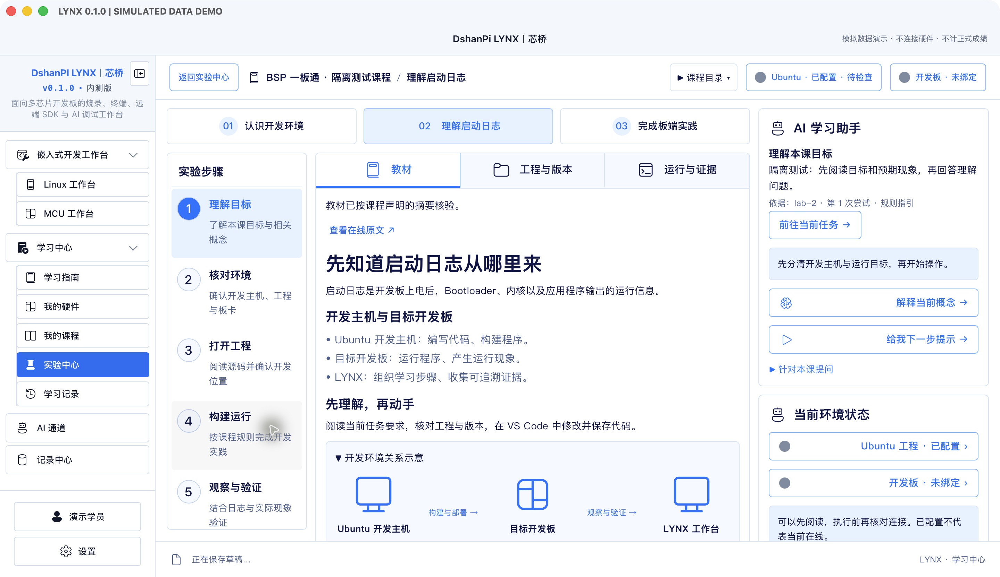
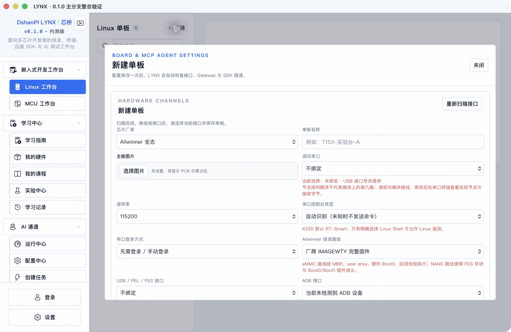
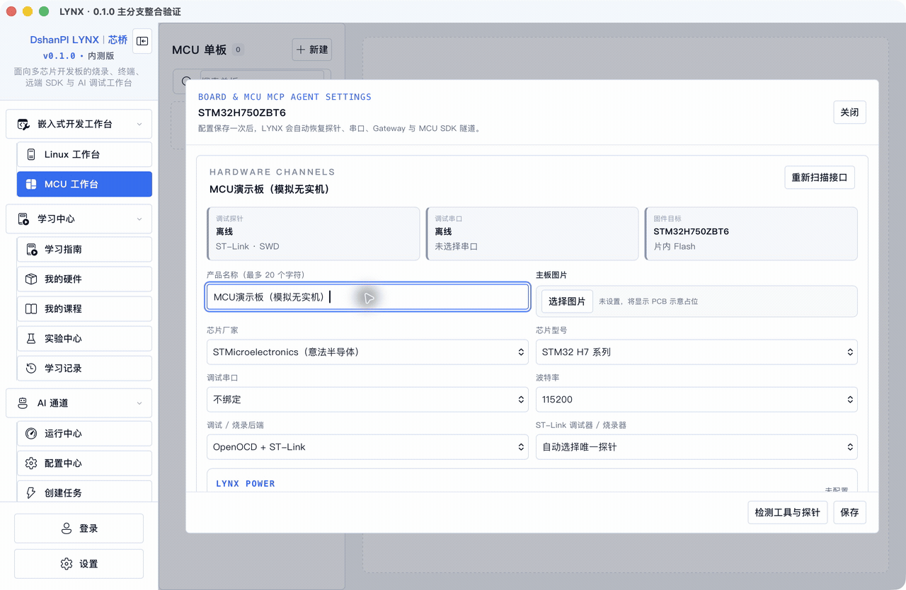
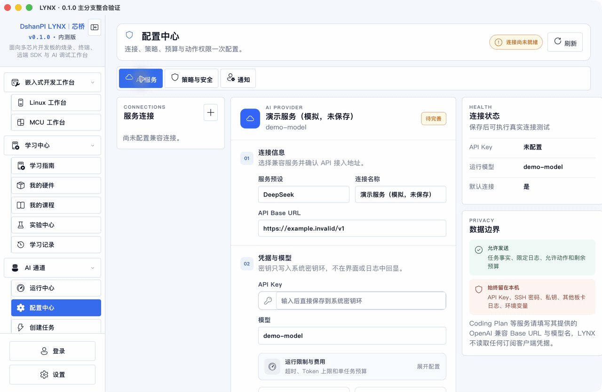
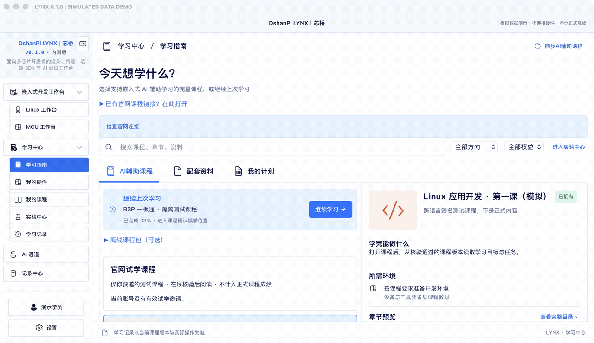

# DshanPI LYNX｜芯桥

**把开发板、开发环境、AI 工具和课程学习放进同一个桌面工作台。**

[版本与下载](https://github.com/dshanpi/lynx-releases/releases) · [快速开始](docs/quick-start.md) · [使用手册](docs/user-guide.md) · [功能演示](docs/demos.md) · [发布状态](docs/release-status.md)

> **0.1.0 正式版准备中，尚无本轮已验收的正式安装包。** 文档和演示不表示安装、签名公证或全部实机验收已完成。下载以 Releases 实际公开的版本为准。

LYNX 面向嵌入式学习者与开发者：在电脑上管理开发板、连接 Ubuntu 开发主机、跟随课程进入 VS Code 编程、检查构建与设备结果，再用 AI 理解问题和整理下一步。

## 你可以用 LYNX 做什么

| 功能区 | 使用方式 | 前提 |
| --- | --- | --- |
| Linux 工作台 | 保存单板配置，绑定串口、USB、ADB，连接 SDK 与 SSH | 正确的板卡、接口和开发环境 |
| MCU 工作台 | 管理 MCU、探针、固件与目标操作 | 支持的探针、芯片及连接配置 |
| 学习中心 | 选择 AI 辅助整课，阅读、实践、记录与复盘 | 已开放的课程与对应权益，或合法本地课程包 |
| AI 通道 | 配置服务、策略、任务，处理人工介入 | 可用模型服务、环境与授权 |
| 记录中心 | 追溯操作、状态、问题和恢复过程 | 已产生的真实操作记录 |

### 围绕单板开发

每块板保存自己的接口和工程配置。板卡串口与 Ubuntu SSH 终端明确区分执行对象；ADB 文件传输位于设备相关功能中。USB、串口换口后可重新发现并保存绑定。

烧录显示进度、校验与终态。设备未连接、被占用或镜像不匹配时先处理原因；传输完成不等于校验通过，发出重启命令不等于系统启动成功。

芯片适配覆盖全志、瑞芯微、NXP i.MX、嘉楠 K230 和 STM32 等方向；具体板型、系统、驱动及镜像组合以版本验收范围为准，不能据厂商名称推断全部型号均已验证。

### 连接 Ubuntu、SDK 与 VS Code

保存开发主机、SSH 身份、工程目录、工具链和目标板，按课程提供的活动进入远程工程或文件。自动化通道核对主机身份，凭据由系统凭据库管理。

打开编辑器、实际修改、构建通过、部署完成和板卡验证分别记录；任何一个状态都不能替代下一步。

### 嵌入式 AI 辅助学习

学习中心专门组织支持 LYNX 的 **嵌入式 AI 辅助整课**。普通视频课、单节内容和零散实验不会自动转换为整课。

课程工作区结合章节导航、教材与代码位置、环境准备、开发结果、AI 指引、复盘和评测。框架面向 KVM、BSP、音视频、Linux 应用及理论课程；具体课程是否上线由发布状态和权益决定，不表示这些课程均已开放。

在线课程优先从账号同步，本地签名课程包是可选路径。学习记录、真实证据和 AI 解释保留各自来源，阅读完成不等同于实操通过。

### AI 指导与受控任务

AI 可解释教材、分析已授权的代码和脱敏日志、提出检查建议。任务能否执行由设备范围、策略、环境、预算和必要确认决定，AI 不能自行修改权威成绩。

## 第一次使用

1. 在 [Releases](https://github.com/dshanpi/lynx-releases/releases) 确认存在适合系统与架构的正式版本。
2. 按 [macOS 安装说明](docs/macos-install.md) 安装并启动。
3. 需要学习时进入学习指南；需要开发时先保存板卡和 Ubuntu 配置。
4. 需要 AI 时配置服务、保存并测试连接。
5. 先完成一次明确的小任务，检查结果和记录，再扩展流程。

## 截图与操作演示

含模拟课程或状态的画面均明确标注。演示不操作真实板卡，不生成正式成绩，不是硬件验收证据。完整索引见 [演示目录](docs/demos.md)。

### 课程工作区（模拟数据）

### Linux 工作台

### 单片机（MCU）工作台

以上为模拟配置和未连接设备状态；实际下载、复位、供电等没有执行。

### AI 配置操作

### 章节切换与复盘草稿（模拟数据）

以上为原生窗口逐步操作截图合成的动图，不是连续录屏。学习示例未连接正式评测服务，画面保留服务不可用提示，不代表线上评测或实验已经通过。[查看全部截图与 MP4](docs/demos.md)。

## 使用文档

- [快速开始](docs/quick-start.md)
- [macOS 安装、迁移与卸载](docs/macos-install.md)
- [完整使用手册：工作台、课程、AI 和记录](docs/user-guide.md)
- [常见问题](docs/faq.md)
- [功能演示与数据说明](docs/demos.md)
- [发布状态和已知限制](docs/release-status.md)
- [0.1.0 版本说明](docs/v0.1.0.md)

## 软件与源码

本仓库只分发安装包和用户资料，**不提供 LYNX 产品源代码**。第三方组件遵循各自随附许可；本仓库公开不代表产品源码开放或获得再分发授权。

公开反馈不得包含 API Key、SSH 密码、私钥、订单号、账号令牌、私人项目正文或未脱敏日志。
