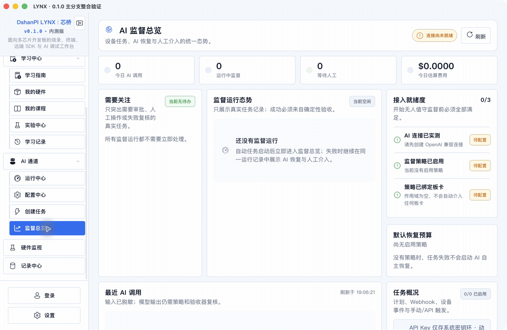
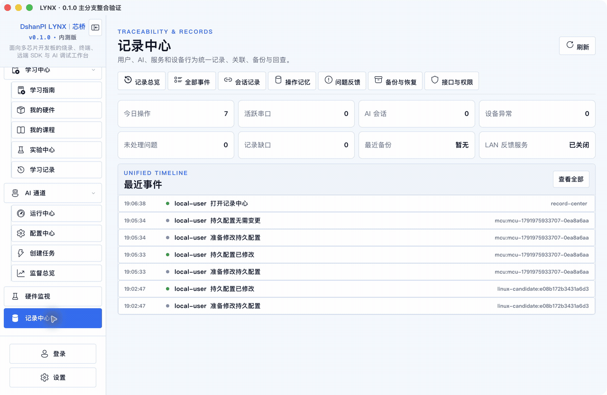
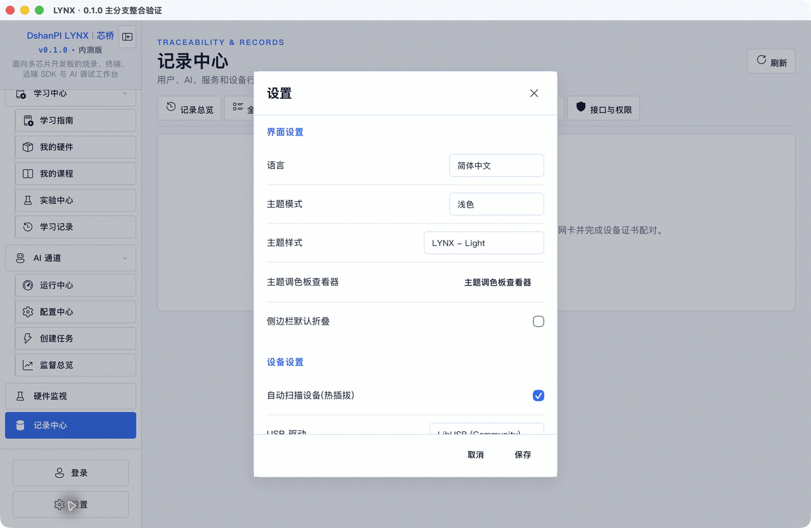
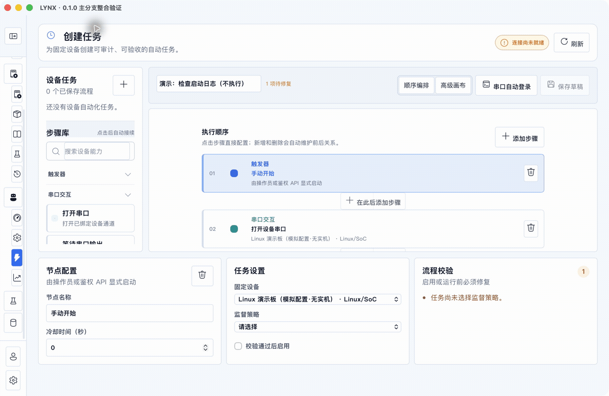
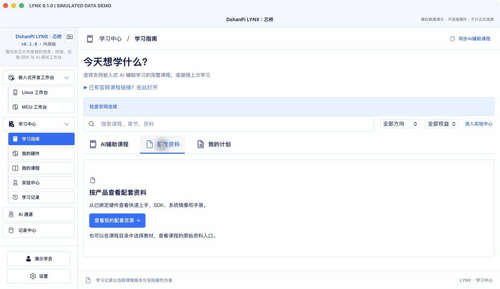
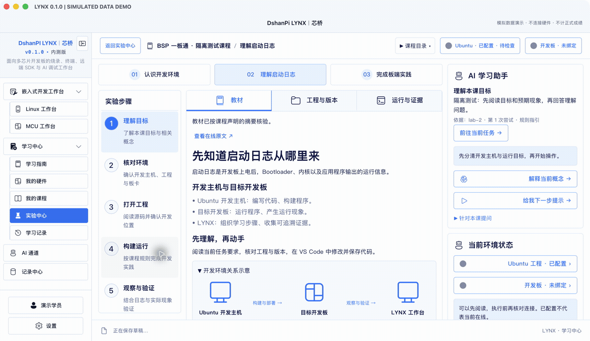
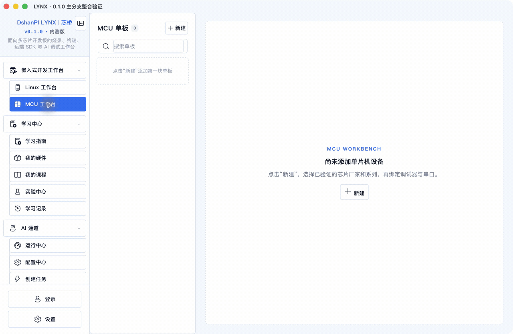

# 全功能演示目录

本页按实际导航覆盖 Linux、单片机、学习中心、AI、任务、监控、记录与设置。每个主题都有 GIF、MP4、步骤截图及执行范围。

素材来自 macOS 原生 Tauri 窗口，使用独立本地数据；学习窗口使用明确标注的模拟数据。GIF/MP4 为操作后截图按每步约 3–4 秒合成的演示，**不是连续录屏**，没有旁白。

**界面操作演示不等于全部业务实测通过。** 本轮未连接真实板卡、未运行实际构建部署、未发送真实订单，不能替代正式课程、安装升级、签名公证或硬件验收。

## 快速索引

| 功能 | 演示 | 主要范围 |
| --- | --- | --- |
| Linux 工作台 | [GIF](../media/gif/linux-workbench.gif) · [MP4](../media/video/linux-workbench.mp4) | 9 个界面步骤 |
| 单片机（MCU）工作台 | [GIF](../media/gif/mcu-workbench.gif) · [MP4](../media/video/mcu-workbench.mp4) | 6 个界面步骤 |
| 运行中心、监督与硬件监视 | [GIF](../media/gif/operations.gif) · [MP4](../media/video/operations.mp4) | 4 个界面步骤 |
| 记录中心 | [GIF](../media/gif/records.gif) · [MP4](../media/video/records.mp4) | 7 个界面步骤 |
| 设置与外观 | [GIF](../media/gif/settings.gif) · [MP4](../media/video/settings.mp4) | 3 个界面步骤 |
| 自动任务编排 | [GIF](../media/gif/task-editing.gif) · [MP4](../media/video/task-editing.mp4) | 2 个界面步骤 |
| 课程资源、权益与学习记录 | [GIF](../media/gif/learning-resources.gif) · [MP4](../media/video/learning-resources.mp4) | 7 个界面步骤 |
| BSP 学习：教材、工程、证据和章节总结 | [GIF](../media/gif/learning-practice.gif) · [MP4](../media/video/learning-practice.mp4) | 7 个界面步骤 |
| AI 服务与策略 | [GIF](../media/gif/ai-configuration.gif) · [MP4](../media/video/ai-configuration.mp4) | 示例字段、预算、策略 |
| 章节草稿 | [GIF](../media/gif/learning-demo.gif) · [MP4](../media/video/learning-demo.mp4) | 输入、切章和返回 |
| 全局导航 | [GIF](../media/gif/navigation.gif) · [MP4](../media/video/navigation.mp4) | 首次使用与页面切换 |

## 1. Linux 工作台

新建模拟单板，查看接口、设备概览、Ubuntu 配置、板卡串口、SSH、固件入口和设备 AI 通道。先明确开发主机与目标板的职责，再绑定真实接口。

**本次范围：** 无实际板卡或 SSH 连接。主机填写 example.invalid 示例，不保存密码或发送连接测试。ADB 上传下载、VS Code 启动、构建部署、烧录和电源动作尚未实操。

[观看 MP4](../media/video/linux-workbench.mp4)

| 步骤 | 高清截图 |
| --- | --- |
| 创建单板：名称、芯片路线、串口和 USB 绑定 | [查看](../media/screenshots/linux-01.png) |
| 摄像头与电源控制器配置 | [查看](../media/screenshots/linux-02.png) |
| 概览：设备状态、ADB 与缺失绑定 | [查看](../media/screenshots/linux-03.png) |
| Ubuntu SDK：主机、用户名、工程目录 | [查看](../media/screenshots/linux-sdk-01.png) |
| 板卡串口：未绑定时的提示 | [查看](../media/screenshots/linux-04.png) |
| SSH：主机尚未配置的恢复入口 | [查看](../media/screenshots/linux-05.png) |
| 本地固件：镜像选择与烧录准备 | [查看](../media/screenshots/linux-06.png) |
| AI/MCP 烧录入口 | [查看](../media/screenshots/linux-07.png) |
| 设备 AI 通道：作用域、连接与工具配置 | [查看](../media/screenshots/linux-08.png) |

## 2. 单片机（MCU）工作台

以 STM32H7 模拟配置展示芯片、探针、串口、概览、固件和 MCU AI 通道。实际使用须按板卡型号、探针和接线配置，不能直接照搬演示值。

**本次范围：** 未绑定真实探针或串口，未执行固件写入、擦除、复位或电源操作。保存配置后应用自动尝试识别，画面保留识别失败日志；READY 配置状态不等于已连接目标。

[观看 MP4](../media/video/mcu-workbench.mp4)

| 步骤 | 高清截图 |
| --- | --- |
| 创建 MCU：厂商、系列、型号、探针与接口 | [查看](../media/screenshots/mcu-01.png) |
| 概览：目标、内存和寄存器信息入口 | [查看](../media/screenshots/mcu-02.png) |
| 串口与识别失败输出 | [查看](../media/screenshots/mcu-03.png) |
| 探针配置与未确认目标 | [查看](../media/screenshots/mcu-04.png) |
| 固件地址、下载准备与未就绪门禁 | [查看](../media/screenshots/mcu-05.png) |
| MCU AI 通道与远端工程入口 | [查看](../media/screenshots/mcu-06.png) |

## 3. 运行中心、监督与硬件监视

先查看监督总览和运行中心，再看硬件监视、通知设置。正在运行、等待人工介入、失败和完成应分别理解；设备离线时不应展示虚假的读数。

**本次范围：** 本例没有运行中的自动任务。硬件监视显示 CH347 未发现；没有采样、电气测量或控制外接设备。通知配置只查看，未发送。

[观看 MP4](../media/video/operations.mp4)

| 步骤 | 高清截图 |
| --- | --- |
| 监督总览：状态、预算与人工介入入口 | [查看](../media/screenshots/operations-01.png) |
| 运行中心：首次使用空状态 | [查看](../media/screenshots/operations-02.png) |
| 硬件监视：离线和连接提示 | [查看](../media/screenshots/operations-03.png) |
| 通知配置 | [查看](../media/screenshots/operations-04.png) |

## 4. 记录中心

按总览、全部事件、会话记录、操作记忆、问题反馈、备份恢复、接口权限查看。先定位事件及上下文，再准备必要且脱敏的问题描述。

**本次范围：** 事件来自本地演示配置，不包含真实账号或工程。操作记忆当前显示未启用。没有提交问题、执行备份恢复或开放局域网服务。

[观看 MP4](../media/video/records.mp4)

| 步骤 | 高清截图 |
| --- | --- |
| 记录总览 | [查看](../media/screenshots/records-01.png) |
| 事件筛选与详情 | [查看](../media/screenshots/records-02.png) |
| 会话记录 | [查看](../media/screenshots/records-03.png) |
| 操作记忆：当前未启用 | [查看](../media/screenshots/records-04.png) |
| 本地问题草稿 | [查看](../media/screenshots/records-05.png) |
| 备份与恢复入口 | [查看](../media/screenshots/records-06.png) |
| 接口与权限：局域网服务关闭 | [查看](../media/screenshots/records-07.png) |

## 5. 设置与外观

查看主题、语言等设置，预览深色外观，再查看更新、版本与诊断信息。演示结束取消设置，不覆盖日常偏好。

**本次范围：** 没有执行更新安装，也不证明升级路径已验收。窗口版本为本轮候选版本，仍处于正式发布准备阶段。

[观看 MP4](../media/video/settings.mp4)

| 步骤 | 高清截图 |
| --- | --- |
| 通用与外观设置 | [查看](../media/screenshots/settings-01.png) |
| 深色主题预览 | [查看](../media/screenshots/settings-02.png) |
| 更新、关于与诊断入口 | [查看](../media/screenshots/settings-03.png) |

## 6. 自动任务编排

从串口自动登录模板生成节点，查看顺序编排和高级画布，选择固定设备并检查缺失策略。只有校验通过且目标、权限及环境满足要求后才能启用。

**本次范围：** 演示任务标为“不执行”，未保存或启用。部分节点仍不可选，不能当作可运行能力。当前画布适配在此窗口尺寸仍会裁切节点，该录像保留修复前的现象；源码现已修复并通过隔离组件检查，最终安装包仍待复核。当前包可先使用顺序编排核对完整步骤。

[观看 MP4](../media/video/task-editing.mp4)

| 步骤 | 高清截图 |
| --- | --- |
| 顺序编排、固定目标与缺失策略 | [查看](../media/screenshots/tasks-01.png) |
| 高级画布：节点连线与当前适配限制 | [查看](../media/screenshots/tasks-02.png) |

## 7. 课程资源、权益与学习记录

展示配套资料、学习计划、订单兑换入口、模拟硬件资源、我的课程、实验中心和学习档案。先获得相应权益，再选课、准备环境，最后回看记录。

**本次范围：** 所有课程、资源和权益为隔离模拟数据，保留水印。没有输入订单、调用官网兑换或写入真实成绩。报告和下载选项为界面展示，未执行正式导出。

[观看 MP4](../media/video/learning-resources.mp4)

| 步骤 | 高清截图 |
| --- | --- |
| 学习指南：配套资料 | [查看](../media/screenshots/learn-more-01.png) |
| 学习计划与继续学习 | [查看](../media/screenshots/learn-more-02.png) |
| 我的硬件：订单兑换入口 | [查看](../media/screenshots/learn-more-03.png) |
| 模拟产品配套资料与课程指引 | [查看](../media/screenshots/learn-more-04.png) |
| 我的课程：教材与活动 | [查看](../media/screenshots/learn-more-05.png) |
| 实验中心：在线与可选离线入口 | [查看](../media/screenshots/learn-more-06.png) |
| 学习档案：阶段总结和导出选项 | [查看](../media/screenshots/learn-more-07.png) |

## 8. BSP 学习：教材、工程、证据和章节总结

进入课程后查看教材、工程与版本、运行与证据；回答理解题，进入下一步规划，展开 AI 提问，再查看章节评测。顶部主机和板卡状态与中间活动相互对应。

**本次范围：** 使用隔离的模拟课程与预置结果。画面中的软件通过是模拟记录，不是实际构建证据；未执行 SSH、VS Code、构建、摄像头采集或板卡验证。AI 面板展示提问方式，没有调用模型。

[观看 MP4](../media/video/learning-practice.mp4)

| 步骤 | 高清截图 |
| --- | --- |
| 教材、步骤与右侧指导 | [查看](../media/screenshots/practice-01.png) |
| 工程路径、代码/SDK/镜像版本与 IDE 入口 | [查看](../media/screenshots/practice-02.png) |
| 运行结果、证据和摄像头启用入口 | [查看](../media/screenshots/practice-03.png) |
| 理解检查：先作答再规划 | [查看](../media/screenshots/practice-04.png) |
| 下一步计划与模拟尝试记录 | [查看](../media/screenshots/practice-05.png) |
| 分级 AI 指引和针对当前课提问 | [查看](../media/screenshots/practice-06.png) |
| 章节总结：目标、结果、解释与补学 | [查看](../media/screenshots/practice-07.png) |

## 9. AI 服务、策略和预算

填写示例名称与 example.invalid 地址，展开运行限制并查看策略。没有输入密钥、保存连接或发送测试。通知入口见运行与监督演示。

[观看 MP4](../media/video/ai-configuration.mp4) · [服务](../media/screenshots/ai-service.png) · [预算](../media/screenshots/ai-limits.png) · [策略](../media/screenshots/ai-policy.png)

## 10. 课程切换和草稿

输入复盘、切换章节后返回，查看原章节输入。此示例没有正式评测与 AI 服务，保留服务不可用状态。离开课程前仍需保存草稿；这段演示不证明退出应用后恢复或跨端同步成功。

[观看 MP4](../media/video/learning-demo.mp4) · [指南](../media/screenshots/learning-guide-demo.png) · [教材](../media/screenshots/course-workspace-demo.png) · [草稿](../media/screenshots/reflection-draft-demo.png)

## 11. 全局导航

MCU 工作台 → 学习指南 → 实验中心 → AI 配置 → 创建任务。独立未登录实例显示首次使用空状态。

[观看 MP4](../media/video/navigation.mp4) · [MCU 空状态](../media/screenshots/mcu-workbench.png) · [任务入口](../media/screenshots/task-builder.png)

## 仍需真实环境补录的操作

- Linux：串口收发、ADB 上传/下载/取消、SSH 多终端、VS Code 打开实际工程、真实构建和部署。
- 固件与目标：Linux/MCU 下载、读回校验、启动、复位及供电控制。
- AI 与任务：真实模型调用、已授权任务执行、取消、恢复与人工介入。
- 学习：正式权益兑换、在线课程同步、真实证据、正式报告导出和跨端同步。
- 硬件监视与摄像头：真实采样、图像采集和权限交互。

这些项目已有入口与流程说明，但本轮未演示真实执行，不能称为全功能实机验证。

媒体 SHA-256 见 [校验清单](../media/SHA256SUMS.txt)。产品源码、演示适配器与内部脚本不在公开仓库中。
